

  
  <h1>Open Mic AI</h1>
  
Free, local voice typing and AI editing. Across your apps.

  

    
    
    
    
    
  

  
<a href="https://github.com/Franklin-C/open-mic-ai/releases">Downloads</a> · <a href="docs/windows.md">Windows guide</a> · <a href="docs/macos.md">Mac guide</a> · <a href="#features">Features</a>

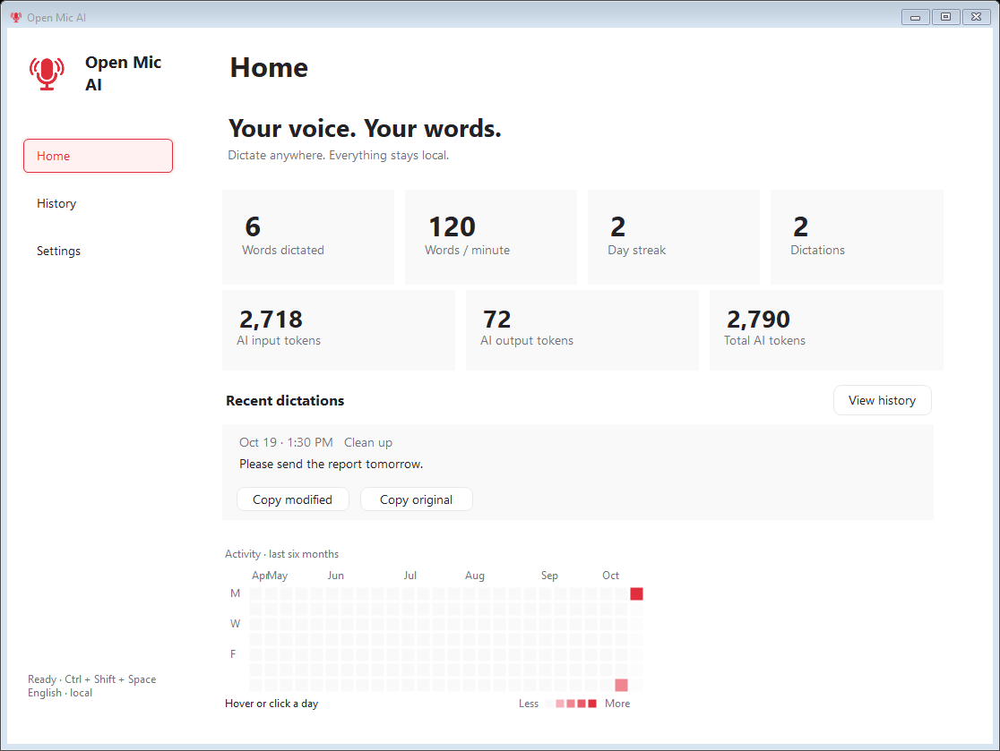

**Turn your voice into ready-to-use writing, with AI that runs on your computer.**
Open Mic AI stays in the background. Click a text box, press one shortcut, and
speak. Choose a raw transcript, a quick cleanup, or polished formatting, then
have it pasted at your cursor. Highlight existing text to rewrite, translate,
or summarize it with the same shortcut.

**Dictate anywhere you type.** The floating bar follows your workflow across apps,
without a browser extension. Automatic paste and selected-text capture depend on
the text field's accessibility support. Windows also reads selections through a
clipboard fallback for canvas editors such as Google Docs. Copy is always available.

No account, subscription, API key, or hosted inference service. Download your
models once and keep speaking offline.

**Windows** is the existing native app. **macOS** is a new native Swift preview
for Apple Silicon and Intel. The Mac port needs real-device testing of microphone
permissions, audio devices and accessibility across third-party apps; it does not
yet have every Windows feature.

## Start speaking

1. Download your platform's app from [Releases](https://github.com/Franklin-C/open-mic-ai/releases).
2. Open **Settings → Models**, choose speech and language models, and click **Download & load models**.
3. Wait for **Ready**, click a text box, and press **Ctrl + Shift + Space** (Mac: **Control + Shift + Space**).
4. Speak. Press again to finish, or choose hold-to-talk or automatic stopping.

Both engines remain loaded while the app runs. Internet is needed for the initial
model downloads; dictation and editing run locally afterward. The app downloads
weights separately so the executable stays small. Download sizes are shown in the
model selectors.

## Choose how your words appear

| Style | What it does |
| --- | --- |
| **Raw transcript** | Speech-model text without AI editing. |
| **Clean up** | Removes fillers and fixes grammar and punctuation. |
| **Polish → My words** | Formatting, punctuation and capitalization with your own wording. No added words or invented heading labels. |
| **Polish → Reworded** | Clearer phrasing plus context-aware formatting, while preserving meaning. |
| **Custom** | Your own instructions in an inline prompt box. |

All writing formats live under **Settings → Style → Polish → Format**. Choose
**Auto**, or pick a message, paragraphs, bullet list, goals, instructions,
recipe, report, email, table, blog post, essay, meeting notes, checklist, outline,
proposal, agenda, FAQ, social post or script. Auto uses the resident local LLM;
there is no extra model download. Tables include only supplied values and copy
as rich tables in compatible editors, with plain-text tables for other fields.
Polish keeps
meaningful introductions, descriptions, quantities, conditions and closing
requests. “My words” renders the model's layout with the original words when
needed, and checks wording and completeness before accepting it. Reworded output
still receives a local meaning check. Quantity corrections update an earlier list
item instead of adding a duplicate. Failed dictation edits
get one retry, then retain the transcript; rejected selected-text edits leave the
original unchanged. Model checks reduce errors, but are not a guarantee of perfect
meaning or speech recognition.

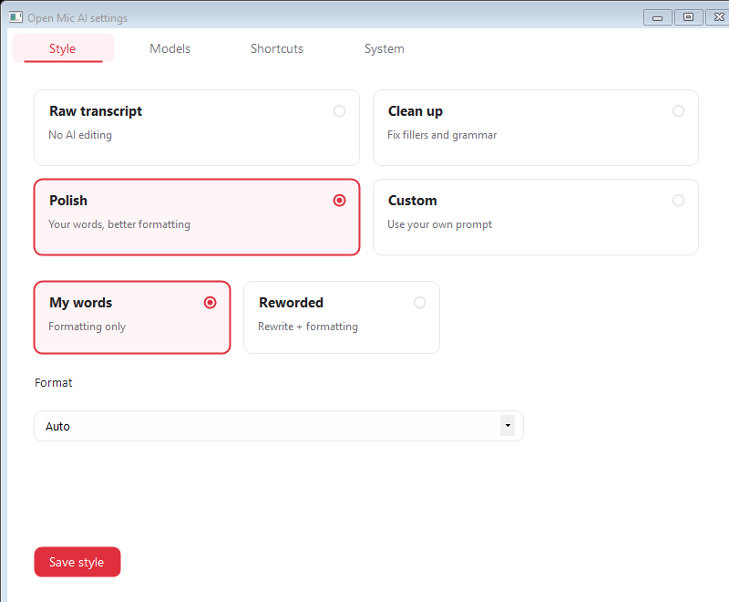

## The floating bar

Drag it where you want it. See provisional words while speaking, an animated
indicator while AI finishes, and a result card when you translate or summarize.

<table>
<tr><th>Ready</th><th>Speaking</th><th>AI formatting</th></tr>
<tr>
<td></td>
<td>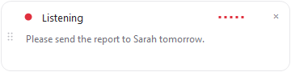</td>
<td>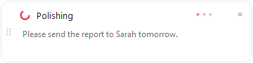</td>
</tr>
</table>

<table><tr><th>Highlighted text</th><th>Summary result</th></tr><tr>
<td>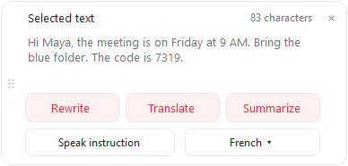</td>
<td>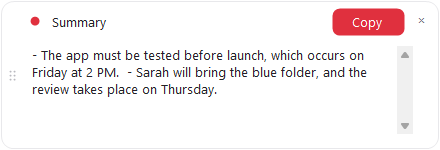</td>
</tr></table>

These are captures of the Windows interface using synthetic examples. A still
image shows one frame of the recording and processing animations.

## Features

**✓** Included · **✕** Unavailable · **-** Not documented. Checked October 12, 2026.

| Feature | **Open Mic AI** | **Wispr Flow** | **OpenWhispr** | **Superwhisper** | **VoiceInk** |
| --- | :---: | :---: | :---: | :---: | :---: |
| Desktop apps | Windows; Mac preview | Windows, Mac | Windows, Mac, Linux | Windows, Mac | Mac |
| Dictate into a text box and paste automatically | ✓ | ✓ | ✓ | ✓ | ✓ |
| Recognize speech offline | ✓ | ✕ | ✓ | ✓ | ✓ |
| Clean up and format text with offline AI | ✓ | ✕ | ✓ | Message and Mail modes | Refine or local Ollama |
| Run custom AI instructions offline | ✓ | ✕ | Translation prompts | ✕ | Local Ollama setup |
| Choose speech and language models independently | ✓ | - | ✓ | ✓ | ✓ |
| Download local models inside the app | ✓ | ✕ | ✓ | ✓ | ✓ |
| Custom AI instructions | ✓ | Spoken commands | Translation prompts | ✓ | ✓ |
| Highlight text, then say how to rewrite it | ✓ | ✓ Paid Command Mode | ✓ Voice agent | ✓ Custom mode | ✓ Context and prompt setup |
| Translate text into other languages | ✓ Multiple languages | - | ✓ | ✓ Custom mode | Custom prompt |
| Dictation speech languages | English | Multiple | Multiple | Multiple | Multiple |
| Personal vocabulary and spelling corrections | ✓ | ✓ | ✓ | ✓ | ✓ |
| Expand a spoken phrase into saved text | ✓ | ✓ | ✓ | ✓ | ✓ |
| Save and revisit dictation results | ✓ | ✓ | ✓ | ✓ | ✓ |
| Validate that formatting adds no new words | ✓ My words | - | - | - | - |
| Cost | Free | Free tier; paid unlimited | Free local; paid cloud | Free dictation; paid AI | Paid app; free source build |
| Open-source app | ✓ MIT | - | ✓ MIT | - | ✓ GPL-3.0 |
| Automatically choose a style for each app | ✕ | ✓ | - | ✓ | ✓ |
| Record meetings with speaker labels | ✕ | ✓ | ✓ | ✓ | - |
| Transcribe imported audio or video files | ✓ | - | ✓ | ✓ Pro | ✓ |

In **History**, choose **Import file** to transcribe a recording locally. Keep the
original transcript or apply your writing style, then copy the result. Supported
formats depend on your operating system's installed media codecs. Imports stay in
history when history saving is enabled; no audio copy is saved.

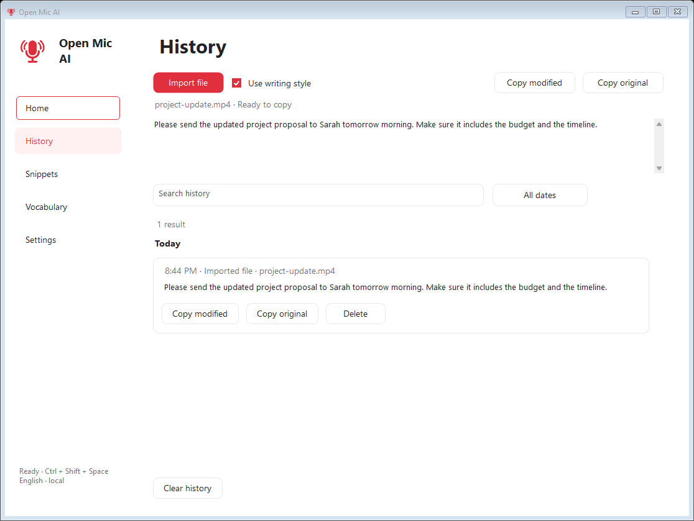

## Inside the app

<table><tr>
<td>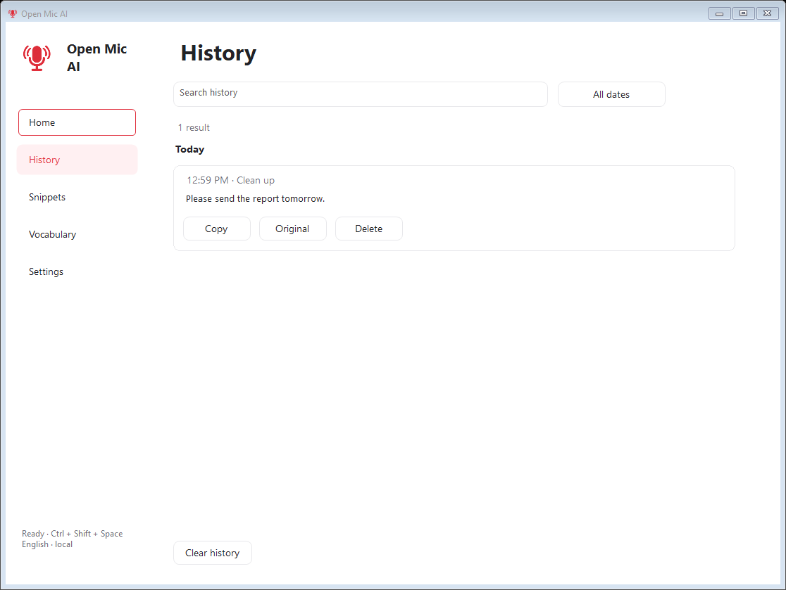</td>
<td>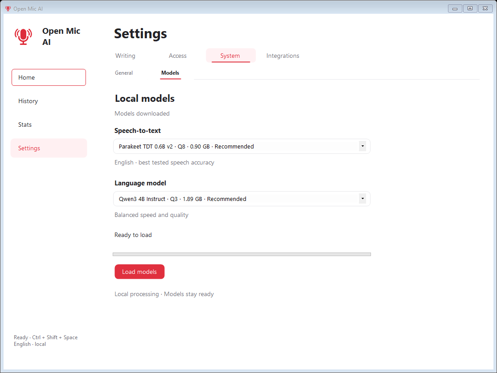</td>
</tr><tr>
<td>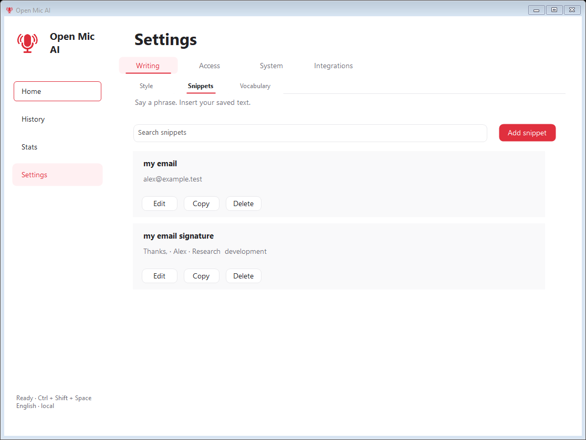</td>
<td>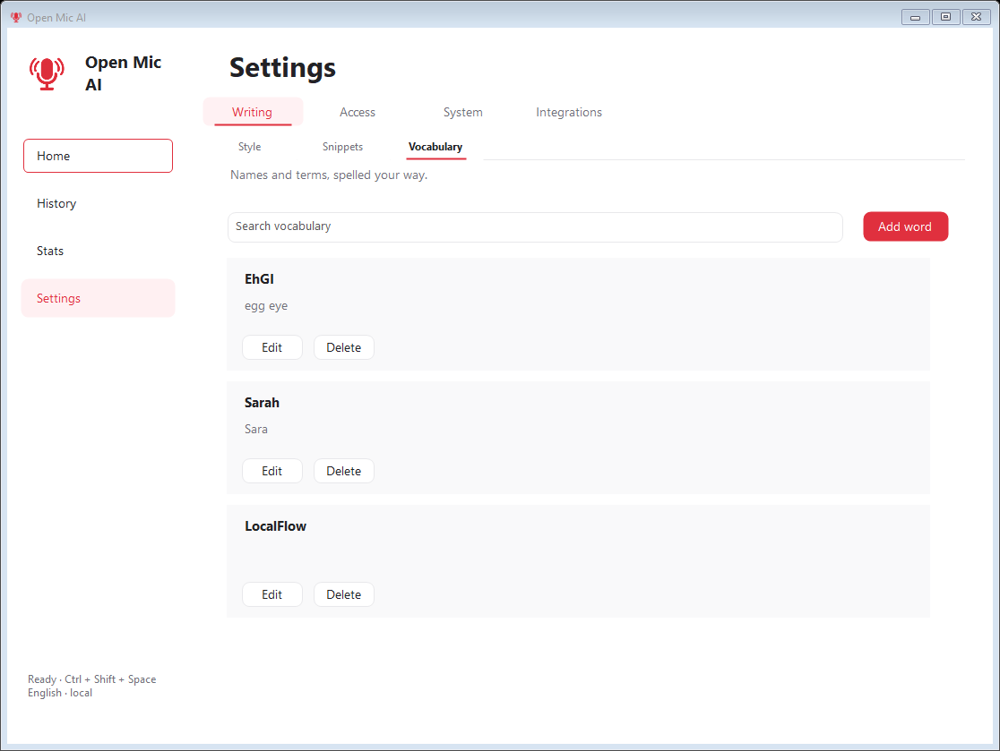</td>
</tr></table>

## Privacy

There is no hosted inference service, account requirement, subscription, or
telemetry integration. Speech and editing requests go to local engines. Audio is
processed in memory and not saved. Optional history and preferences stay in your
app data folder. Model files come from pinned upstream revisions and are checked
against SHA-256 hashes. See [Security and privacy](SECURITY.md).

## Build and contribute

- **Windows:** .NET Framework 4.8; run `windows/Build.ps1`. No NuGet packages are required. Run `windows/validation/RunCoreChecks.ps1` for offline word-guard and retry checks. Native integration tests require locally installed models.
- **Mac:** macOS 13+, Xcode command-line tools, CMake and Git; run `bash macos/build.sh`. The script tests Swift code, builds the pinned speech and language engines, and packages an app for your architecture.

CI builds Windows and both Mac architectures. Mac packages use a development
signature and are not notarized. The downloadable Windows portable app includes
its engines; the thin Windows source-build artifact requires those engines
separately. See the platform guides for details.

The app source is [MIT licensed](LICENSE). Models and inference engines have their
own licenses: [Windows notices](windows/THIRD_PARTY_NOTICES.txt),
[Mac notices](macos/THIRD_PARTY_NOTICES.md).
