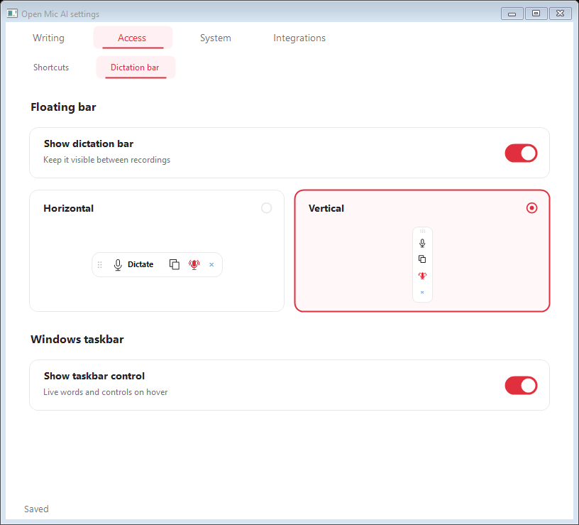
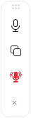
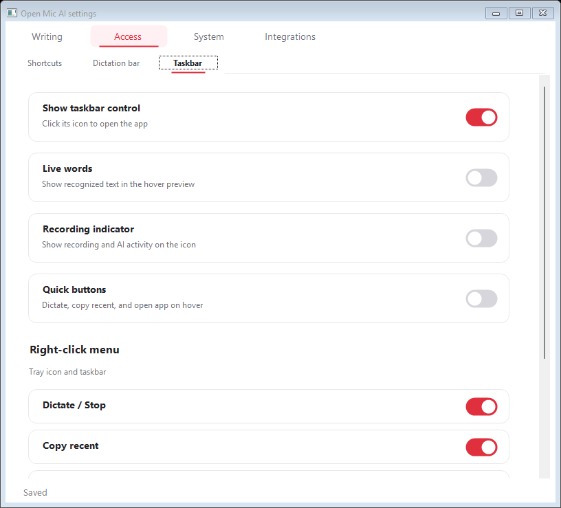
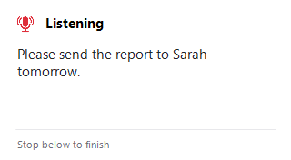
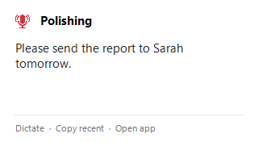

# Dictation bar

Open **Settings → Access → Dictation bar**. Changes save immediately.

- **Show dictation bar** keeps it visible between recordings. Listening, selected-text tools, and AI results still appear when needed.
- **Horizontal** uses the compact toolbar. **Vertical** stacks the same controls in a narrow bar.
- Drag the dotted grip to move it. Recording and result cards expand so the words remain readable.

## Windows taskbar control

Open **Settings → Access → Taskbar**, immediately to the right of **Dictation bar**. Turn on **Show taskbar control**; it starts off.

Hover over the Open Mic AI taskbar entry to see recognized words and three controls:

- **Dictate / Stop** starts recording and finishes with a second click.
- **Copy recent** copies the latest result.
- **Open app** opens the main window.

Click the taskbar icon or single-click the tray icon to open the app. Independently toggle **Live words**, the **Recording indicator**, and **Quick buttons**. Recording buttons keep the editor focused so automatic paste can use the original text box. Closing the taskbar entry turns this option off; the app stays available in the tray.

Under **Right-click menu**, choose the app actions shown by both the tray icon and the Windows Jump List: Dictate / Stop, Copy recent, Open app, Show dictation bar, Settings, and Quit. Changes save immediately. The tray keeps an informational status line; other legacy tray entries are removed. Windows manages its own Pin and Close entries. Quit closes the app, just like Quit in the tray.

App-provided preview content, rendered with synthetic text:

The taskbar control is Windows-only. macOS has horizontal and vertical floating bars and the existing menu-bar controls.

Stream Deck setup is under **Settings → Integrations**. See the [Stream Deck guide](stream-deck.md).
