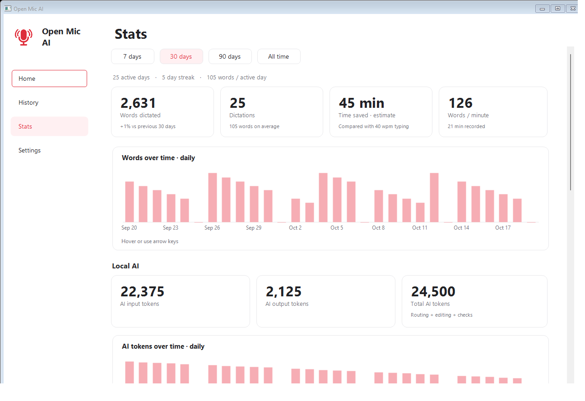
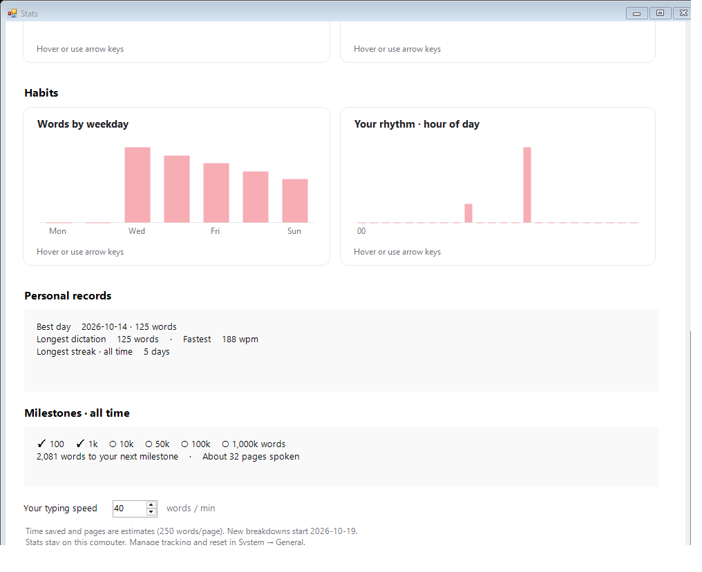

# Stats

Open **Stats**, just below **History**. Choose **7 days**, **30 days**, **90 days**, or **All time**.

| Measure | What it tells you |
| --- | --- |
| Words and dictations | How much you dictated, with a comparison against the previous equal-length period. |
| Average length | Words per dictation. |
| Words per minute | Timed words divided by total recording time, rather than an average of individual speeds. |
| Time saved | Estimated typing time minus recording time. Change **Your typing speed** to suit you. |
| Active days | Days with at least one dictation in the chosen period. |
| Daily words and AI tokens | Hover or select a bar to see its date and count. Longer periods use weekly buckets; All time charts show the last 90 days. |
| AI input, output and total | Counts reported by the local language model, including layout planning, editing and repair checks. Speech models do not contribute to these token counts. |
| Apps and writing styles | Where you dictate and which styles you use most. |
| Weekdays and hours | When you do your most voice typing, in local time. |
| Personal records | Best day, longest dictation and fastest eligible dictation in the selected period. |
| Streaks | Current and longest lifetime streaks. Yesterday's streak stays current until today ends. |
| Milestones | Word-count achievements from 100 to one million, words remaining, and an estimated page equivalent. |

Time saved is an estimate, not measured productivity. It uses only sessions with a recorded duration, excludes processing time, and never goes below zero. Pages use 250 words per page. The fastest-dictation record requires at least ten words and ten seconds, so a tiny burst cannot set the record.

Word statistics count voice dictation; selected-text commands and imported recordings are excluded. Their AI work still contributes to token counts. Empty and cancelled recordings add no dictation. On Windows, a transcript retained after an editing failure can still count as a dictation.

## Local storage and older usage

Statistics store counts, dates, app names and style names on this computer. They do not store transcript text. They continue beyond the 200-result history limit, and deleting history does not delete statistics.

Windows preserves existing lifetime and daily usage. New style, hourly, record, dated-token and date-filtered app breakdowns start with this update; older undated tokens stay in **All time**. Earlier per-day words, lifetime app totals and streaks remain available.

The Mac preview seeds word statistics from the saved history available on first launch after this update. It labels that limitation in Stats; it cannot recover history that was previously deleted or trimmed. Existing undated AI token totals are preserved in **All time**. After that, aggregates persist independently of history.

Use **Settings → System → General → Track usage locally** to pause collection. Existing statistics remain visible. **Reset usage**, followed by **Confirm reset**, clears the saved totals without deleting history. These controls apply to both dictation counts and AI tokens.

The screenshots use synthetic fixtures, not a person's history or a speed benchmark.
